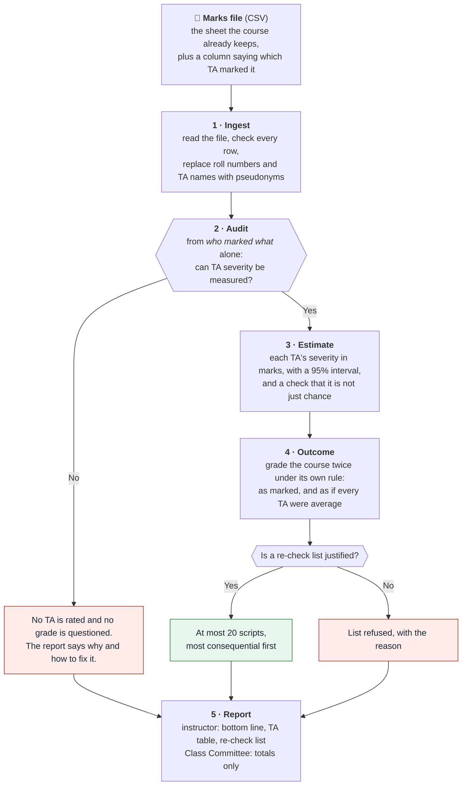
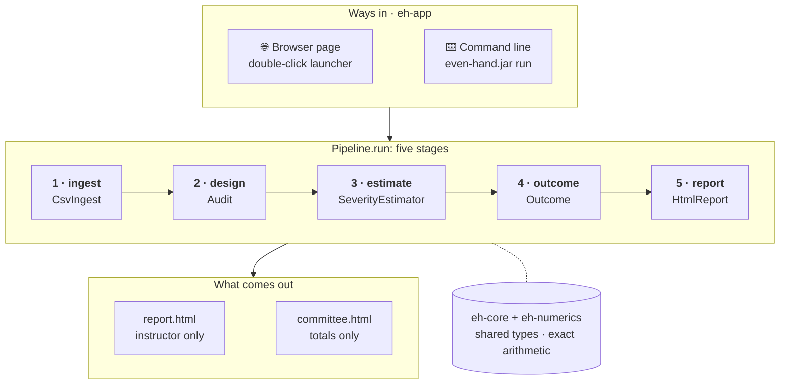
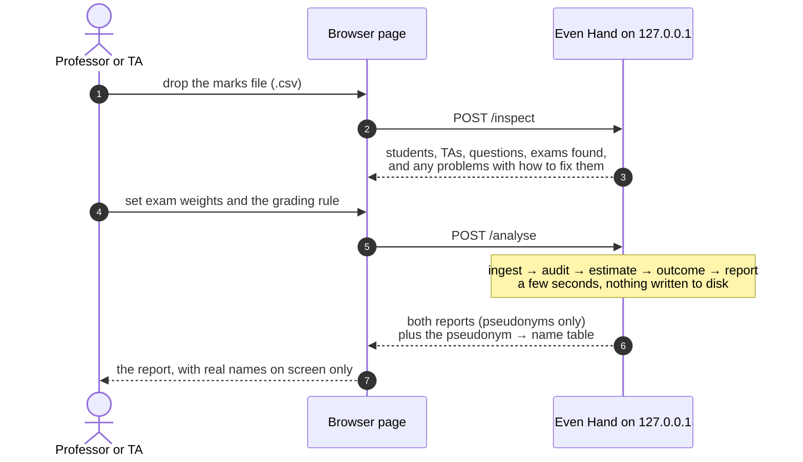

# Even Hand (prototype)

**Did it matter which TA marked the script?** A grading-consistency audit for IIT Madras courses.
CS5013 Programming with AI · Team *God's Eye* · Mohamed Zayaan S (CE23B092), Pruthviraj Milind Chougale (CE23B104)

Large IITM courses are marked by teams of TAs who split the scripts. Some TAs are harsher than
others, and under relative grading (B at the class mean, A one SD above, top 10% S) that is
zero-sum: a leniently marked student who rises into a band pushes someone else out of it.

This prototype does one thing end to end: **you give it the marks file of an online exam (a Google
Forms quiz or an LMS quiz such as Moodle) or the course's mark sheet, and it gives you a report.** The report says whether the marking can be checked, how harsh or lenient each TA was
in marks, how many letter grades that moved, and which few scripts deserve a second look. It
never changes a grade.


## The whole flow



## Run it (Java 21+, nothing else to install)

1. **Open it.** Double-click `even-hand.cmd` (Windows) or run `./even-hand.sh`. A page opens in your
   browser at `http://127.0.0.1:8642`, served by this computer only. The first run builds it (a
   minute or two); after any code change it rebuilds itself.
2. **Drop in the marks file.** The page shows what it read (students, TAs, questions) and anything
   to fix, then asks how much each exam counts.
3. **Press *Check the marking*.** The report opens with a plain-language bottom line. The screen shows
   real roll numbers and TA names; *Save report* saves a copy with pseudonyms only.

No file to hand? Press **Try the example file**, or use the demo files in `samples/demo/` (made-up
courses with known answers; see [`samples/demo/README.md`](samples/demo/README.md)).

From the terminal:

```
./mvnw -q package -DskipTests
java -jar eh-app/target/even-hand.jar run samples/demo/1-course-marks.csv --weights "Quiz 1=20,Quiz 2=20,End-sem=60"
```

This prints each TA's severity with its interval and the re-check list, and writes `report.html`
(instructor) and `committee.html` (Class Committee) to `even-hand-report/`.

### The input file

| Layout | Example header | When |
| --- | --- | --- |
| One row per student | `roll_no, ta, Q1 (10), Q2 (10), Q3 (15), Total` | Each TA marked whole scripts. Write each question's maximum in brackets. Name/Total columns are ignored; blank or `AB` = not answered. |
| One row per answer | `roll_no, assessment, question, max_marks, marks, ta[, role]` | TAs split the paper by question, or some scripts were marked twice (`role` = `record` or `second`). |
| **Google Forms quiz** (responses CSV) | `Timestamp, Email address, Score, Roll number, <answers…>, TA` | Add a `TA` column for who graded each response. `Score` is read as `31 / 40`; the answers are ignored. Forms exports only the total, so each response counts as one question. |
| **LMS quiz** (e.g. Moodle grades CSV) | `Surname, First name, Email address, …, Grade/80.00, Q. 1 /10.00, …, Graded by` | Add a `Graded by` column. Per-question marks are read with the maximum from the header; `Grade/…`, "Requires grading" cells and the "Overall average" row are skipped. |

Column names are matched loosely: `student`, `Roll No`, `Email address`, `grader`, `TA`, `Graded by`,
`marker`, `score`, `marks`, `maxscore`, `out_of` and so on. Institute e-mail addresses
(`ce24b013@smail.iitm.ac.in`) are read as roll numbers. A second row for the same student, graded by
another TA, is read as a moderation re-mark: the first row counts, and the pair links the two TAs. Even the first experiment's file, `early-data-cleaner/Book1.csv`, is read
as it is (it has one TA, so the report explains there is no one to compare).

## How it works: five stages, one module each



| Module | Stage | Key class | What it does |
| --- | --- | --- | --- |
| `eh-ingest` | 1 | `CsvIngest`, `WideSheet` | Reads either file layout; replaces roll numbers and TA names with keyed pseudonyms (HMAC-SHA-256) before anything else sees them; reports every bad row with its line number. |
| `eh-design` | 2 | `IdentifiabilityAudit` | From the allocation alone: can TA severity be separated from student ability (exact integer rank), and could it have moved anyone (exposure)? |
| `eh-estimate` | 3 | `SeverityEstimator`, `Backfit` | Fits `mark% = mean + ability + easiness − severity` by repeated weighted averages. 95% intervals by resampling the students; a no-effect test reshuffles the file's own students to check the differences are not chance. |
| `eh-outcome` | 4 | `Outcome`, `GradingRule`, `Composite` | Grades as marked vs corrected under the course's rule; the re-check list needs p < 0.05, a ≥ 20% chance of a grade change, and is capped at 20. |
| `eh-report` | 5 | `HtmlReport` | Instructor report with a bottom line; Class Committee sheet with totals only. |
| `eh-app` | — | `Pipeline`, `Main`, `LocalServer` | `Pipeline.run` is the five stages in order; the CLI and the browser page (JDK HTTP server on 127.0.0.1) both call it. |
| `eh-core`, `eh-numerics` | — | `FittedModel`, `ExactRowSpace` | Shared types and exact arithmetic. |

### The eight modules, class by class

`eh` stands for *Even Hand*. Think of an exam office with one desk per stage, a shared dictionary
and a calculator that every desk uses, and a reception that connects them:

```
Front desk  →  Inspector  →  Analyst  →  Registrar  →  Writer
 (ingest)       (design)     (estimate)   (outcome)     (report)
        shared dictionary (core) + exact calculator (numerics)
              the building and its reception (app)
```

**1. `eh-core`: the shared dictionary.** No steps, only the words every module uses.

| Class | In plain words |
| --- | --- |
| `Response` | One mark: which student, which question, which TA, the score, out of what |
| `DesignCell`, `MarkingDesign` | Who marked what, without the marks. The audit sees only this |
| `AllocationEvidence` | Facts about how scripts were split: roll-number blocks? by department? |
| `AuditVerdict`, `Exposure` | The audit's answer: can TAs be compared, and could anyone have been affected |
| `IdentifiabilityCertificate` | Proof of the audit's check, tied to this exact course |
| `Anchoring`, `AnchoredDesign` | The convention that the TAs' severities average to zero |
| `FittedModel`, `FacetEstimates`, `Facet` | The estimates: each TA's severity, its 95% range and the no-effect p-value; numbers for one facet (students, questions or TAs) |
| `CutoffPolicy`, `LetterGrade` | The course's grading rule (relative or absolute, top 10% S) and the grades S to U with their points |
| `Diagnostic` | A message: what is wrong, how serious, how to fix it |
| `CourseProfile`, `Arrangement` | The marking set-up in words: script-wise, question-wise, and so on |
| `Provenance`, `Provenanced`, `ScoreType` | Small labels: was a setting given or assumed; what kind of marks these are |

**2. `eh-numerics`: the calculator.**

| Class | In plain words |
| --- | --- |
| `ExactRowSpace` | The audit's linear algebra in exact fractions, so a verdict never depends on rounding |
| `SymmetricEigen` | An independent floating-point method the tests use to cross-check it |

**3. `eh-ingest`: the front desk (stage 1).** Reads the file and hides identities before anyone else sees them.

| Class | In plain words |
| --- | --- |
| `CsvIngest` | Reads the CSV, finds columns by name, reports bad rows with line numbers, never guesses a question's maximum |
| `WideSheet` | Reads one-row-per-student sheets, Google Forms (`31 / 40`) and Moodle (`Q. 1 /10.00`) exports, and unpacks them to one row per answer |
| `Pseudonymiser` | Replaces identities with keyed pseudonyms: CE24B013 → "Student 12", a TA → "Assistant 3" (HMAC-SHA-256) |
| `KeyFile` | Optionally keeps that key, encrypted under a passphrase (AES-256-GCM) |
| `RollNumbers` | Reads department and order from roll numbers, to spot piles split by department or in blocks |

**4. `eh-design`: the inspector (stage 2, the audit).** Looks only at who marked what, and decides whether TAs can be compared at all.

| Class | In plain words |
| --- | --- |
| `ExposureAudit` | Could anyone be affected? Did students meet different mixes of TAs? |
| `IdentifiabilityAudit` | Can each pair of TAs be compared? Verdict: estimable, only if piles were alike, partly, or not at all |
| `DesignMatrix` | Writes "who marked what" as a 0/1 grid for the calculator |
| `DesignProfiler` | Names the arrangement in plain words for the report |

**5. `eh-estimate`: the analyst (stage 3).** Works out how strict each TA was, how sure we are, and whether it could be luck.

| Class | In plain words |
| --- | --- |
| `Observations` | Turns every mark into a percentage of its maximum (8/10 → 80) and gives longer questions more weight |
| `Backfit` | The rounds of guessing: students, then questions, then TAs, until the numbers settle |
| `SeverityEstimator` | Runs `Backfit` once, then 200 resamples for the ranges and 99 reshuffles for the no-effect test, and returns a `FittedModel` |
| `Settings` | The dials: shrinkage (5 and 50), 200 resamples, 99 reshuffles, a fixed random seed |

**6. `eh-outcome`: the registrar (stage 4).** Asks whose grade would change.

| Class | In plain words |
| --- | --- |
| `Composite` | Each student's weighted total, as marked and as corrected (the severity given back) |
| `GradingRule` | Letter grades under the course's own rule: B at the class mean with SD bands and top 10% S, or fixed cut-offs |
| `Outcome` | Compares the two grades over the 200 resamples, keeps students who change in at least 1 in 5, ranks them, caps the list at 20, or refuses and says why (`Gate`) |

**7. `eh-report`: the writer (stage 5).**

| Class | In plain words |
| --- | --- |
| `ReportInput` | Everything the report needs, in one place |
| `HtmlReport` | The instructor report (bottom line, TA table and chart, grade changes, re-check list) and the Class Committee sheet (totals only) |

**8. `eh-app`: the building and its reception.** What you actually run.

| Part | In plain words |
| --- | --- |
| `Pipeline` | Walks the file through the five stages in order |
| `Main` | The commands: `serve` (open the page) and `run file.csv` (terminal) |
| `LocalServer` | A small web server on 127.0.0.1 only: serves the page and runs the pipeline on each click |
| `upload.html` | The page: drop a file, check what was read, set weights, read the report |
| `CourseConfig` | The instructor's choices: course name, exam weights, grading rule |
| `Json` | Packs the results into the form the page reads |
| `example-marks.csv` | The file behind the *Try the example file* button |

In one line: a shared vocabulary (`core`), an exact calculator (`numerics`), one module per stage
(`ingest`, `design`, `estimate`, `outcome`, `report`), and `app`, which connects them for the
browser and the terminal.

### What happens when you press *Check the marking*



## Scope, and what comes next

This prototype works on **digital marks**: online exams on Google Forms or an LMS, and mark sheets
kept in Excel. The next phase is **scanned answer scripts and question papers**: reading the
pictures of handwritten answer sheets (and the question paper, for each question's maximum) into
the same marks file, so paper exams flow through the same pipeline unchanged.

## Build and test

```
./mvnw verify       # all modules and their tests
```

The tests use small marks files with known answers (in each module's `src/test`), so every check
compares the algorithm with a result it should produce: exact recovery of planted severities,
recovery within 1.5 points from a noisy file, a no-effect test that neither cries wolf nor misses
real differences, the audit's verdicts on question-wise and department-aligned marking, and no
roll number in any report.

## Privacy

Runs on the instructor's own computer and makes no network call; an architecture test enforces it.
Roll numbers and TA names become pseudonyms at the first step. Nothing is written to disk unless the
instructor saves a report, and saved reports carry pseudonyms only. Real marks are git-ignored; the
files in `samples/demo/` are made-up examples.

## Repository layout

```
eh-core  eh-numerics  eh-ingest  eh-design  eh-estimate  eh-outcome  eh-report  eh-app   the prototype (Maven modules)
samples/demo/            four demo marks files with a planted answer key, and how to show them
early-data-cleaner/      the first data-cleaning experiment (DataCleaner.java), kept for history
even-hand.cmd / .sh      double-click launchers
```
