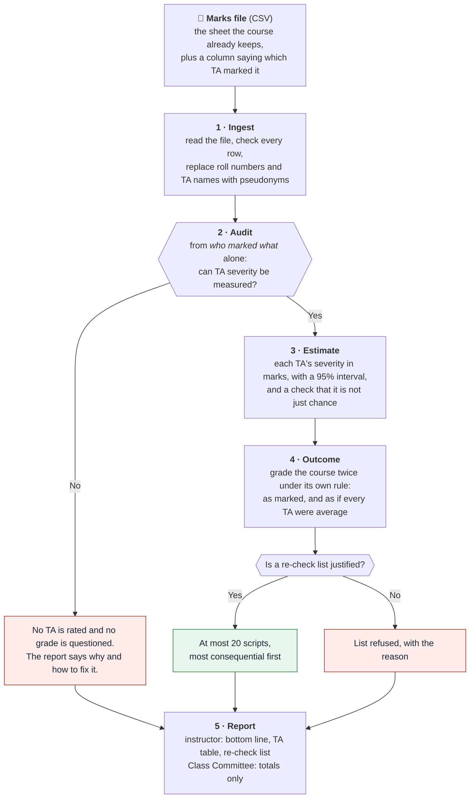
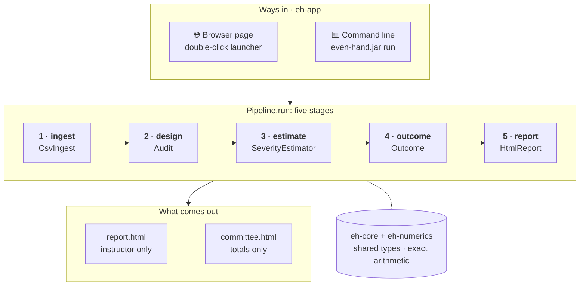
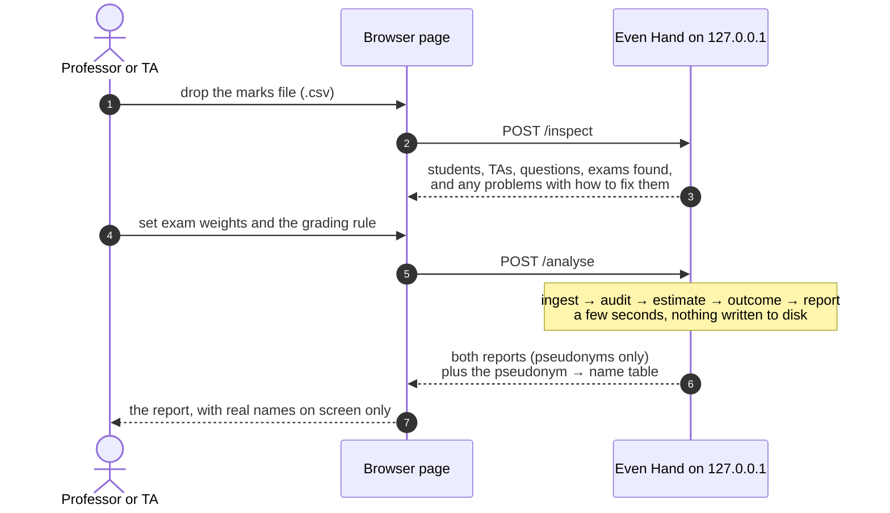

# Even Hand (prototype)

**Did it matter which TA marked the script?** A grading-consistency audit for IIT Madras courses.
CS5013 Programming with AI · Team *God's Eye* · Mohamed Zayaan S (CE23B092), Pruthviraj Milind Chougale (CE23B104)

Large IITM courses are marked by teams of TAs who split the scripts. Some TAs are harsher than
others, and under relative grading (B at the class mean, A one SD above, top 10% S) that is
zero-sum: a leniently marked student who rises into a band pushes someone else out of it.

This prototype does one thing end to end: **you give it the course's marks file, and it gives you
a report.** The report says whether the marking can be checked, how harsh or lenient each TA was
in marks, how many letter grades that moved, and which few scripts deserve a second look. It
never changes a grade.

It is the core pipeline of the full project ([Zayaan3019/Even_Hand](https://github.com/Zayaan3019/Even_Hand))
with the course simulator, Simulation Lab and benchmark left out.

## The whole flow



## Run it (Java 21+, nothing else to install)

1. **Open it.** Double-click `even-hand.cmd` (Windows) or run `./even-hand.sh`. A page opens in your
   browser at `http://127.0.0.1:8642`, served by this computer only. The first run builds it (a
   minute or two); after any code change it rebuilds itself.
2. **Drop in the marks file.** The page shows what it read (students, TAs, questions) and anything
   to fix, then asks how much each exam counts.
3. **Press *Check the marking*.** The report opens with a plain-language bottom line. The screen shows
   real roll numbers and TA names; *Save report* saves a copy with pseudonyms only.

No file to hand? Press **Try the example file**, or use `samples/example-marks.csv`.

From the terminal:

```
./mvnw -q package -DskipTests
java -jar eh-app/target/even-hand.jar run samples/example-marks.csv --weights "Quiz 1=25,Quiz 2=25,End-sem=50"
```

This prints each TA's severity with its interval and the re-check list, and writes `report.html`
(instructor) and `committee.html` (Class Committee) to `even-hand-report/`.

### The input file

| Layout | Example header | When |
| --- | --- | --- |
| One row per student | `roll_no, ta, Q1 (10), Q2 (10), Q3 (15), Total` | Each TA marked whole scripts. Write each question's maximum in brackets. Name/Total columns are ignored; blank or `AB` = not answered. |
| One row per answer | `roll_no, assessment, question, max_marks, marks, ta[, role]` | TAs split the paper by question, or some scripts were marked twice (`role` = `record` or `second`). |

Column names are matched loosely: `student`, `Roll No`, `grader`, `TA`, `marker`, `score`, `marks`,
`maxscore`, `out_of` and so on. Even the first experiment's file, `early-data-cleaner/Book1.csv`, is read
as it is (it has one TA, so the report explains there is no one to compare).

## How it works: five stages, one module each



| Module | Stage | Key class | What it does |
| --- | --- | --- | --- |
| `eh-ingest` | 1 | `CsvIngest`, `WideSheet` | Reads either file layout; replaces roll numbers and TA names with keyed pseudonyms (HMAC-SHA-256) before anything else sees them; reports every bad row with its line number. |
| `eh-design` | 2 | `IdentifiabilityAudit` | From the allocation alone: can TA severity be separated from student ability (exact integer rank), and could it have moved anyone (exposure)? |
| `eh-estimate` | 3 | `SeverityEstimator`, `Backfit` | Fits `mark% = mean + ability + easiness − severity` by repeated weighted averages. 95% intervals by resampling the students; a no-effect test reshuffles the file's own students to check the differences are not chance. |
| `eh-outcome` | 4 | `Outcome`, `GradingRule`, `Composite` | Grades as marked vs corrected under the course's rule; the re-check list needs p < 0.05, a ≥ 20% chance of a grade change, and is capped at 20. |
| `eh-report` | 5 | `HtmlReport` | Instructor report with a bottom line; Class Committee sheet with totals only. |
| `eh-app` | — | `Pipeline`, `Main`, `LocalServer` | `Pipeline.run` is the five stages in order; the CLI and the browser page (JDK HTTP server on 127.0.0.1) both call it. |
| `eh-core`, `eh-numerics` | — | `FittedModel`, `ExactRowSpace` | Shared types and exact arithmetic. |

### What happens when you press *Check the marking*



## Build and test

```
./mvnw verify       # all modules and their tests
```

The tests use small marks files with known answers (in each module's `src/test`), so every check
compares the algorithm with a result it should produce: exact recovery of planted severities,
recovery within 1.5 points from a noisy file, a no-effect test that neither cries wolf nor misses
real differences, the audit's verdicts on question-wise and department-aligned marking, and no
roll number in any report.

## Privacy

Runs on the instructor's own computer and makes no network call; an architecture test enforces it.
Roll numbers and TA names become pseudonyms at the first step. Nothing is written to disk unless the
instructor saves a report, and saved reports carry pseudonyms only. Real marks are git-ignored; the
files in `samples/` are made-up examples.

## Repository layout

```
eh-core  eh-numerics  eh-ingest  eh-design  eh-estimate  eh-outcome  eh-report  eh-app   the prototype (Maven modules)
samples/                 example-marks.csv (one row per answer), example-sheet.csv (one row per student)
early-data-cleaner/      the first data-cleaning experiment (DataCleaner.java), kept for history
even-hand.cmd / .sh      double-click launchers
```
